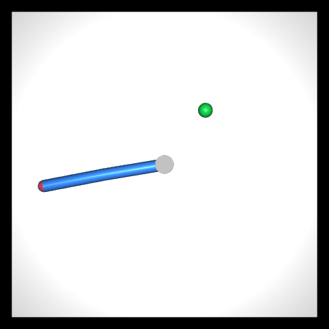
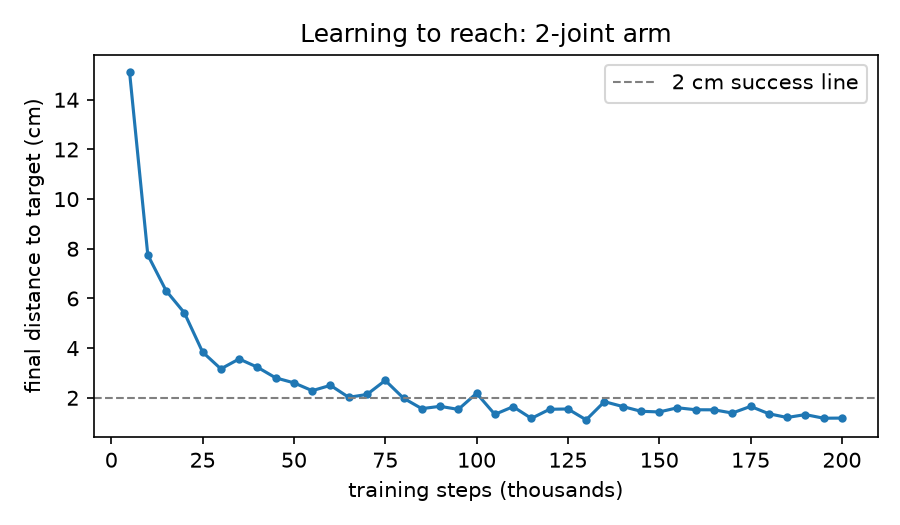

# arm-adapt



**Robots trained on one body break when you change the body. How badly, and can one policy handle bodies it has never seen?**
Week 1: a simulated 2-joint arm (MuJoCo) learns to reach random targets with reinforcement learning (SAC), trained in 5.5 minutes on a laptop CPU.

| Policy (200 unseen targets, 20 cm arm) | Avg final distance | Within 2 cm |
|---|---|---|
| Random actions | 17.9 cm | 0.5% |
| **Trained SAC, 200k steps** | **1.5 cm** | **77.5%** |



## Run it

Needs [uv](https://docs.astral.sh/uv/).

```bash
uv sync                     # install dependencies
uv run python train.py      # train the 2-joint arm (~5 min on an M-series CPU)
uv run python evaluate.py   # scores, GIF and learning curve into results/
```


How it all works, file by file: [TECHNICAL.md](TECHNICAL.md)
